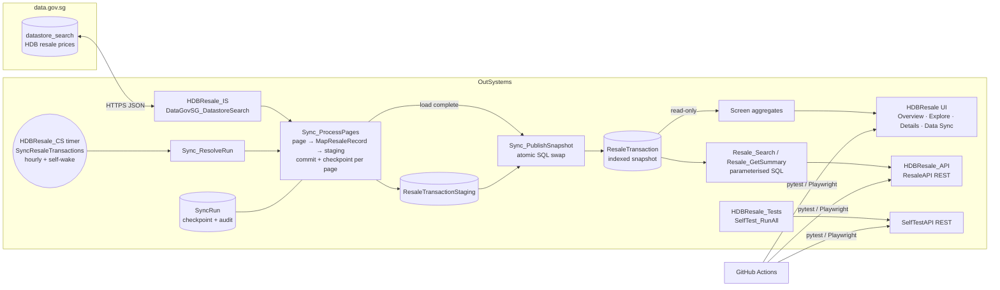
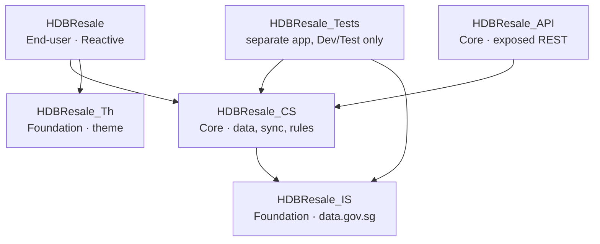
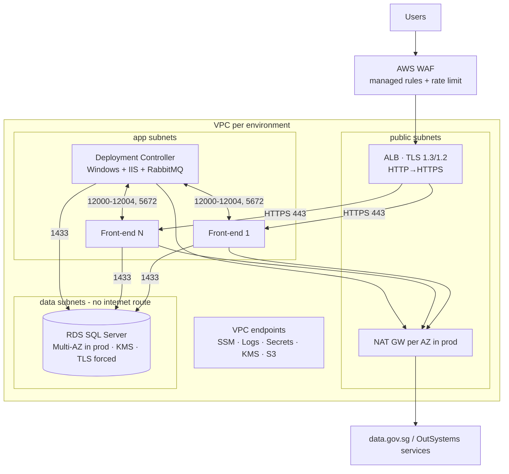

# HDB Resale Explorer — OutSystems + data.gov.sg

A full-stack OutSystems 11 (Reactive Web) application that lets citizens and policy
officers explore **every HDB resale flat transaction registered since January 2017**
(~244,000 rows), sourced from data.gov.sg. This repository contains everything that is
not inside the OutSystems module itself: the **AWS Infrastructure as Code** for running
the OutSystems Platform, the **automated tests**, the **CI/CD pipelines** and this
documentation.

| Deliverable | Where |
|---|---|
| OutSystems applications: six modules (`HDBResale_Th`, `HDBResale_IS`, `HDBResale_CS`, `HDBResale_API`, `HDBResale`, `HDBResale_Tests`) | OutSystems environment `personal-ejuytnht.outsystemscloud.com` (access provided separately) |
| AWS IaC for the OutSystems Platform | [`infra/terraform`](infra/terraform) |
| Automated tests | [`tests`](tests) + in-platform `SelfTest_RunAll` + [`infra/terraform/tests`](infra/terraform/tests) |
| CI/CD | [`.github/workflows`](.github/workflows), [`scripts/lifetime_deploy.py`](scripts/lifetime_deploy.py) |
| Design decisions | [`docs/architecture.md`](docs/architecture.md) |

---

## 1. What the application does

**Dataset:** [Resale flat prices based on registration date from Jan-2017 onwards](https://data.gov.sg/datasets/d_8b84c4ee58e3cfc0ece0d773c8ca6abc/view)
(Housing & Development Board, resource `d_8b84c4ee58e3cfc0ece0d773c8ca6abc`). I chose it
because it is large, refreshed monthly and of broad public interest, and it
supports more than a table: you can segment it, rank it, trend it over time and compare a
single sale with the market.

| Screen | Access | Capabilities |
|---|---|---|
| **Overview** (`Dashboard`, default) | Public | Segment by town, flat type and period. Shows KPI counters (transactions, average price, average price per sqm, highest price), a monthly price trend (line chart), the flat-type mix (donut chart) and a ranking of average price by town (bar chart). Deep-links into the explorer with the same filters. Shows data freshness. |
| **Explore** (`Transactions`) | Public | Search by street or block; filter by town, flat type, price range and date range; server-side sort on any column; pagination; empty and loading states. |
| **Transaction details** | Public | Full record. Compared with its 12-month segment (same town and flat type): segment average, % above/below average, average price per sqm and highest price. Lists other sales in the same block. |
| **Data Sync** | `DataAdmin` role | Load history with status tags and progress, snapshot size, and a "Refresh data now" button (role-checked on the server). |
| **REST API** `/HDBResale_API/rest/ResaleAPI` | Public, read-only | `GET /transactions`, `GET /summary` (includes the median), `GET /health`. |

## 2. Architecture



**The key design decision is to sync and cache the data, not proxy it.** The UI never calls
data.gov.sg at request time. A timer copies the dataset into the OutSystems database, and
every screen queries local, indexed tables. Why:

* **Rate limits and latency.** data.gov.sg rate-limits anonymous traffic and takes 3–6 s
  per 1,000-row page. Live proxying would make every filter change slow and would fail
  under load.
* **Interactive analytics.** Aggregations (averages by town or month, the median,
  comparisons with the segment) need the whole dataset. The datastore API offers only
  simple filters and offsets.
* **Availability.** If data.gov.sg is down, the app keeps serving the last good snapshot,
  and `/health` reports it as `STALE`.

**The sync is resumable and consistent.** Upstream `_id`s are *not stable*: data.gov.sg
republishes the dataset, and I saw recent months re-ordered at the tail. Incremental sync
by `_id` would therefore create duplicates or miss rows. Instead, each load is a
**full snapshot**:

1. `Sync_StartRun` records the remote row count, clears the staging table and creates a
   `SyncRun` at offset 0.
2. `Sync_ProcessPages` fetches pages of `Site.Sync_PageSize` rows (sorted by `_id`),
   validates and maps every row (`MapResaleRecord`) into staging, and **commits after
   every page together with the advanced checkpoint**. A crash, timeout or API error
   loses at most one page, and the next run resumes from the checkpoint.
3. If the remote total changes mid-load, `DatasetChangedException` fails the run and a
   fresh one starts straight away.
4. `Sync_PublishSnapshot` swaps staging into `ResaleTransaction` with `DELETE` +
   `INSERT…SELECT` **in one transaction**, so readers see either the old or the new
   snapshot, never a mix.
5. The timer processes `Site.Sync_MaxPagesPerRun` pages per execution (well within its
   timeout) and wakes itself until the load is finished. A load with no heartbeat for
   `Site.Sync_StaleRunMinutes` is marked Abandoned and replaced.

More detail, alternatives and trade-offs are in [`docs/architecture.md`](docs/architecture.md).

### Module structure (Architecture Canvas)

Six modules; references point only downwards (or End-user → Core). The rationale is in
[ADR-8](docs/architecture.md#adr-8-split-into-modules-along-the-architecture-canvas).



| Module | Elements |
|---|---|
| `HDBResale_IS` | Private REST consumer `DataGovSG` (`DatastoreSearch`, JSON structures); public wrapper `DataGovSG_DatastoreSearch` returning DTOs `ResaleRecordDTO` / `DatastorePage`; optional `x-api-key` header from `Site.DataGovSG_ApiKey` (secret, not sent when empty) |
| `HDBResale_CS` | Entities `ResaleTransaction` (read-only public; indexes on month, town + flat type + month, street + block), `SyncRun` (read-only public), static `SyncStatus`, private `ResaleTransactionStaging`. Pure, unit-tested rules `ParseMonthText`, `ParseRemainingLeaseMonths`, `MapResaleRecord`. Sync `Sync_ResolveRun`, `Sync_StartRun`, `Sync_ProcessPages`, `Sync_PublishSnapshot`, `Sync_UpdateRunStatus`, timer `SyncResaleTransactions`. Services `Resale_Search`, `Resale_GetSummary`, `Resale_GetHealth`, `Admin_RequestRefresh`. Role `DataAdmin`. Site properties `DataGovSG_ResourceId`, `Sync_*` |
| `HDBResale_API` | Exposed REST `ResaleAPI`: `/transactions`, `/summary`, `/health` (HTTP mapping only) |
| `HDBResale` | `MainFlow`: `Dashboard` (default), `Transactions`, `TransactionDetail`, `DataSync` (`DataAdmin`); screen aggregates over CS's read-only entities; OutSystems Charts |
| `HDBResale_Th` | Theme `HDBResale` on OutSystems UI: the whole design (palette, cards, filter panel, KPI cards, tables, page headers, login). The `HDBResale` app theme only extends it and adds no CSS |
| `HDBResale_Tests` | `SelfTest_RunAll` (20 table-driven cases), exposed REST `SelfTestAPI` (`/run`), `Site.SelfTests_Enabled` |

**Demo accounts (Dev/Test only).** The `EnsureDemoUsers` timer in `HDBResale_Tests` runs on
every publish and calls `DemoUsers_Ensure`. It creates or resets `demo.admin` (granted
`DataAdmin`) and `demo.viewer` (registered user, no `DataAdmin`), using the Users module's
`EncryptPassword`, so passwords are stored hashed. While those accounts exist, the Login
screen shows a "Demo accounts" panel that lists them by name only (Demo Admin, Demo Viewer).
One click calls the `DemoSignIn` server action, which signs the session in and opens the
default page; no password is shown or sent. `DemoSignIn` accepts only those two usernames,
and only if the active account exists. Because the tests app is never deployed to
Production, the accounts do not exist there, so neither the panel nor the sign-in can work.
`test_demo_sign_in_by_name` (E2E) covers both accounts, including that only the admin sees
Data Sync.

**UI.** Every screen follows one pattern: a page title, a one-line intro, a filter panel where relevant, then content cards. Overview shows the monthly trend at full width, then the town ranking and the flat-type mix side by side. The Data Sync menu item only appears for `DataAdmin` users; the menu's `GetMenuAccess` data action checks the role on the server, because roles defined in a Service module have no client-side check. *Theme pitfall:* the platform silently kept serving the previous `HDBResale_Th` stylesheet while it contained an external `@import` and an attribute selector (`a[id*="…"]`). Keep theme CSS free of both. Fonts are module resources: Inter (`inter-latin-wght-normal.woff2`, SIL OFL) is a resource of `HDBResale_Th`, loaded through `@font-face`; the platform rewrites the URL and ships the file with every consuming app. to check a deploy, compare the `Last-Modified` of `/HDBResale_Th/css/HDBResale_Th.HDBResale.css`.

**Security:** `DataAdmin` gates the Data Sync screen **and** is re-checked on the server
inside `Admin_RequestRefresh` (`CheckDataAdminRole()`). Public screens use the Anonymous role.

## 3. Infrastructure as Code (AWS)

[`infra/terraform`](infra/terraform) defines the AWS infrastructure for a **self-managed
OutSystems 11 platform**. There is one state file per environment: `lifetime`, `dev`,
`test` and `prod`.



| Module | Highlights |
|---|---|
| `network` | 3-tier VPC (public / app / data) across 2–3 AZs; data tier has no internet route; NAT per AZ in prod; VPC endpoints so SSM and logging work without the internet; VPC flow logs (KMS); default SG locked down |
| `edge` | ALB with `ELBSecurityPolicy-TLS13-1-2-2021-06`, HTTP→HTTPS 301, re-encryption to targets, `drop_invalid_header_fields`; WAFv2 (Common, KnownBadInputs, SQLi, IP reputation, per-IP rate limit; body-size rule set to *count* for Service Center/LifeTime uploads); access-log bucket (TLS-only policy, lifecycle); optional Route 53 alias |
| `outsystems_servers` | Deployment Controller + N front-ends (Windows Server 2022 from the AWS SSM public AMI parameter); IMDSv2 only; encrypted gp3; **no RDP / key pairs** (SSM Session Manager); least-privilege role (installer bucket, DB secret, KMS); bootstrap installs IIS prerequisites and the CloudWatch agent, then installs and configures the Platform Server. DB credentials are read from Secrets Manager at boot and never stored in user data or state |
| `database` | RDS SQL Server (SE/EE, Express for dev only, enforced by a precondition); KMS encryption; `rds.force_ssl`; RDS-managed master password in Secrets Manager; Multi-AZ, PITR backups, deletion protection and a final snapshot; Performance Insights; enhanced monitoring; error/agent logs to CloudWatch |
| `operations` | SNS alarms (KMS) for ALB 5xx, unhealthy targets, latency, RDS CPU/storage, and EC2 status checks with **auto-recover**; AWS Backup (daily, tag-based); SSM patch baseline plus a maintenance window that patches **one server at a time** to keep the ALB healthy |

Usage:

```bash
cd infra/terraform
terraform init -backend-config=envs/prod.backend.hcl
terraform plan  -var-file=envs/prod.tfvars -out prod.tfplan
terraform apply prod.tfplan
```

Prerequisites outside this stack: an ACM certificate, the Terraform state bucket and lock
table, and a private installer bucket holding `outsystems/<version>/PlatformServer-<version>.exe`
plus `configure-platform.ps1`. Keeping that script with the installer pins the
version-specific Configuration Tool arguments to the platform version.

> **GCC note.** On GCC 2.0 the landing zone already provides the VPC, egress and some
> security controls. The `network` module is then replaced by the agency's existing
> VPC/subnet IDs; the other modules are unchanged.

## 4. Testing strategy

| Level | What | How it runs |
|---|---|---|
| **Unit (in-platform)** | 20 cases covering `ParseMonthText`, `ParseRemainingLeaseMonths` (all upstream lease formats and edge cases) and `MapResaleRecord` (normalisation, price per sqm, each rejection rule). The logic lives in OutSystems, so the tests execute there via `SelfTest_RunAll`. | `GET /HDBResale_Tests/rest/SelfTestAPI/run`, asserted by [`tests/api/test_selftests.py`](tests/api/test_selftests.py) |
| **API / integration** | Response shape, filters (case-insensitive), every sort option, SQL-injection-safe sort, paging without overlap, `maxRecords` clamp, date validation (400), summary consistent with search, median within [min, max], snapshot health | [`tests/api/test_resale_api.py`](tests/api/test_resale_api.py) (pytest) |
| **Upstream contract** | Detects schema or format drift in data.gov.sg *before* it breaks the sync: field set, row-count plausibility, month/lease/storey formats, numeric prices, deterministic `_id` paging | [`tests/contract`](tests/contract), nightly |
| **End-to-end UI** | Dashboard KPIs and charts render; a filter changes the KPIs; explore → filter → sort → detail; pagination; admin screen requires login | [`tests/e2e`](tests/e2e) (Playwright) |
| **IaC** | `fmt`, `validate`, `tflint`, `checkov`, plus `terraform test` with a **mocked AWS provider** asserting invariants: prod is Multi-AZ, encrypted, private and deletion-protected; front-ends (not the controller) serve prod traffic; NAT per AZ; IMDSv2; TLS policy and redirect; WAF on; Express cannot be Multi-AZ; bad inputs rejected | [`infra/terraform/tests`](infra/terraform/tests), every PR |

```bash
pip install -r tests/requirements.txt
pytest tests/contract                       # needs only internet access
export APP_BASE_URL=https://<env>.outsystemscloud.com   # environment root; suites add the module paths
pytest tests/api                            # in-platform unit tests + API tests
python -m playwright install chromium && pytest tests/e2e -m e2e --browser chromium
cd infra/terraform && terraform init -backend=false && terraform test
```

**CI/CD.** [`ci.yml`](.github/workflows/ci.yml) runs the IaC checks and upstream contract
tests on every PR, and nightly runs the full regression against Dev.
[`deploy.yml`](.github/workflows/deploy.yml) uses the **LifeTime Deployment API v2**:
it tags a version in Development, deploys it to Test, runs the regression suite, and only
then promotes **that exact version** to Production behind a protected-environment approval,
followed by a read-only smoke test.

## 5. Security and compliance notes

* Public data, so the screens and API are anonymous and read-only. The only write path
  (`Admin_RequestRefresh`) is gated by the `DataAdmin` role on the screen **and** on the
  server.
* SQL uses parameters only. The sort column is allow-listed inside a `CASE`; there is no
  `Expand Inline`.
* The upstream response is untrusted: every field is validated and length-capped, and bad
  rows are counted and skipped rather than failing the load.
* API keys are secret Site Properties set per environment, marked *sensitive* so they are
  masked in integration logs.
* Infrastructure: encryption at rest (KMS) and in transit (TLS to ALB, ALB → IIS, app →
  SQL), no public IPs on servers, no SSH/RDP, IMDSv2, WAF, flow logs, audit-friendly
  `SyncRun` history.
* `SelfTests_Enabled` should be **False** in Production. The self-tests have no side
  effects, but the endpoint has no purpose there.

## 6. Assumptions, trade-offs and next steps

* **Six modules on the Architecture Canvas** (ADR-8): `HDBResale_Th` and `HDBResale_IS`
  (Foundation), `HDBResale_CS` and `HDBResale_API` (Core), `HDBResale` (End-user), plus
  `HDBResale_Tests` in its own LifeTime application, so `SelfTestAPI` never ships to
  Production. Only CS writes data; its entities are exposed read-only to the UI.
* **Empty values in API JSON.** OutSystems omits attributes that hold their default
  value (`0`, `""`, empty list), so clients should treat a missing `startIndex` as `0`
  and a missing `items` as `[]`. The tests do the same.
* **Full refresh vs incremental.** A full snapshot takes about 245 API calls a day, which
  is trivial for upstream. In exchange it is always correct, even when upstream re-orders
  or revises rows. If the dataset grew 100×, I would switch to month-partitioned refreshes
  (re-load only the trailing N months).
* **Row-by-row inserts** into staging (about 1–2 s per 1,000 rows) are simple and
  transactional per page. A bulk-insert extension could make loads about 10× faster if
  needed.
* **Median** is only exposed through the API, because aggregates can't compute it
  (`PERCENTILE_CONT` needs SQL). Screens use aggregates for platform-optimised,
  automatically paged queries.
* The text search uses `LIKE '%term%'`, which can't use an index. At 244k rows it stays
  sub-second; a full-text index is the next step at larger scale.
* `configure-platform.ps1` (the unattended Configuration Tool call) is intentionally kept
  next to the installer rather than in this repo, because its arguments are
  platform-version specific.
